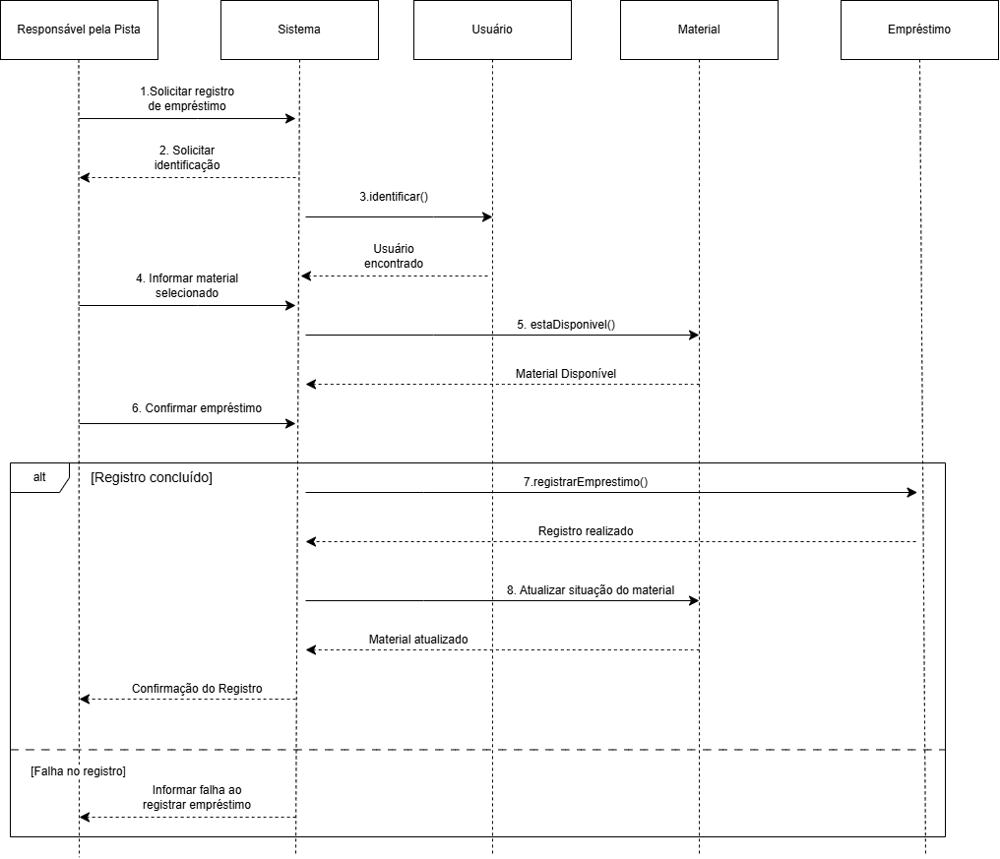

# 4.2.4 Modelagem de Sequência

O diagrama de sequência apresenta a interação entre os participantes durante o caso de uso Registrar empréstimo, mostrando a ordem das mensagens trocadas. Sua construção utiliza como base o fluxo da seção 4.2.2 e as classes e operações definidas na seção 4.2.3.

**Do fluxo às mensagens**
O diagrama de sequência representa a troca de mensagens durante a execução do caso de uso Registrar empréstimo, especificado na seção 4.2.2. Os participantes são definidos a partir das classes apresentadas na seção 4.2.3.

Cada ação do Responsável pela pista vira uma mensagem enviada ao sistema. As operações internas são direcionadas às classes responsáveis por executá-las. As respostas das operações são representadas por setas tracejadas.

| No fluxo da 4.2.2 | Vira a mensagem | De quem para quem | Por quê |
|---|---|---|---|
| Passo 1: o responsável acessa Registrar empréstimo | Solicitar registro de empréstimo | Responsável pela pista → Sistema | O ator inicia o processo |
| Passo 2: o sistema solicita a identificação do usuário | Solicitar identificação | Sistema → Responsável pela pista | O sistema precisa saber quem receberá o material |
| Passo 3: verificar se o usuário está cadastrado | identificar() | Sistema → Usuário | A classe Usuário possui a operação responsável pela identificação |
| Passo 4: o responsável seleciona o material | Informar material selecionado | Responsável pela pista → Sistema | O ator informa qual material será emprestado |
| Passo 5: verificar a disponibilidade do material | estaDisponivel() | Sistema → Material | A classe Material verifica se pode ser emprestado |
| Passo 6: o responsável confirma o empréstimo | Confirmar empréstimo | Responsável pela pista → Sistema | O ator autoriza o registro |
| Passo 7: registrar o empréstimo | registrarEmprestimo() | Sistema → Responsável | A classe Responsável possui a operação de registro |
| Passo 8: atualizar a disponibilidade e apresentar confirmação | Atualizar situação do material e confirmar registro | Sistema → Material / Responsável pela pista | O material passa a constar como emprestado e o responsável recebe a confirmação |

## Diagrama de sequência

Fonte: Autoria própria (2026).

**Descrição da figura**
A Figura 5 apresenta o diagrama de sequência do caso de uso Registrar empréstimo. O diagrama possui cinco linhas de vida: Responsável pela pista, Sistema, Usuário, Material e Empréstimo. Cada uma representa um participante envolvido no processo. O responsável inicia a operação, o sistema coordena as ações e as demais linhas representam as classes que participam das verificações e do registro.

A interação acontece de cima para baixo, seguindo a ordem do fluxo principal da seção 4.2.2. Primeiro, o responsável solicita o registro do empréstimo e o sistema solicita a identificação do usuário. Em seguida, o sistema executa identificar() na classe Usuário e recebe a confirmação de que ele foi encontrado.

Depois, o responsável informa o material selecionado. O sistema chama estaDisponivel() na classe Material e recebe a informação de que o material está disponível. Com isso, o responsável confirma o empréstimo e o sistema inicia o registro.

Por fim, o sistema registra o empréstimo, atualiza a situação do material e envia uma confirmação ao responsável pela pista.

O fragmento combinado alt representa duas possibilidades: no caminho Registro concluído, o empréstimo é registrado, a situação do material é atualizada e o responsável recebe a confirmação. No caminho Falha no registro, o sistema informa que não foi possível registrar o empréstimo e encerra a operação sem concluir o processo.

## Rastreabilidade com a 4.2.3

A tabela relaciona as mensagens do diagrama com as operações e classes definidas na modelagem de classes.

| Mensagem | Chega em | Operação na 4.2.3 | Passo da 4.2.2 |
|---|---|---|---|
|Solicitar registro de empréstimo|Sistema|---|Passo 1|
|Solicitar identificação|Responsável pela pista|---|Passo 2|
|identificar()|Usuário|identificar()|Passo 3|
|Informar material selecionado|Sistema|---|Passo 4|
|estaDisponivel()|Material|estaDisponivel()|Passo 5|
|Confirmar empréstimo|Sistema|---|Passo 6|
|registrarEmprestimo()|Empréstimo|Está definida em Responsável na 4.2.3|Passo 7|
|Atualizar situação do material|Material|---|Passo 8|
|Confirmação do registro|Responsável pela pista|---|Passo 8|

**Análise de rastreabilidade**

**Toda mensagem com parênteses chega em quem tem a operação?**
Não completamente. identificar() e estaDisponivel() estão corretamente relacionadas às suas classes. Porém, registrarEmprestimo() aparece direcionada à classe Empréstimo, enquanto na seção 4.2.3 está definida na classe Responsável. É necessário alinhar os dois modelos.
**Todo passo tem mensagem?**
Sim. Os oito passos do fluxo principal estão representados no diagrama. O passo 8 aparece dividido em atualização da situação do material e confirmação do registro.
**O que o desenho mudou nas suas classes?**
A modelagem de sequência revelou a necessidade de revisar duas operações. A operação registrarEmprestimo() precisa ser alinhada à classe que a executa no diagrama, e a atualização da situação do material precisa ser representada na classe Material, pois ainda não possui uma operação correspondente na 4.2.3.
